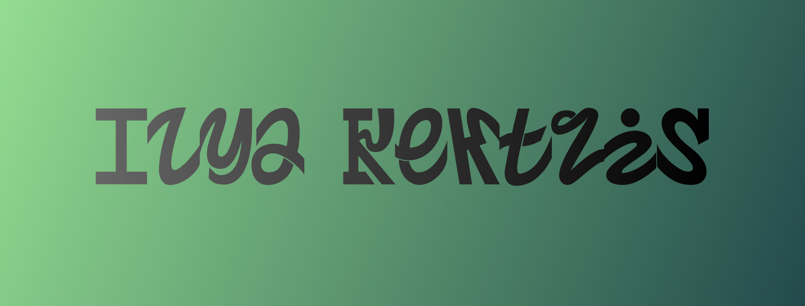

# я илюша
[ENG](https://kektris.github.io/)

Я где то кодер, но в основном саунд-инженер. Особо нечего больше сказать.
## Мои проекты
а где
## Мои девайсы

> Мои телефоны
>> Основа: **Google Pixel 8 8/128** с **Android 17**
>> 
>> Второй: **Xiaomi Mi 8 Lite 4/64** с **DerpFest 15 (Android 15)**
>>
>> Другое барахлище:
>>> **Apple iPhone 6s 2/64**
>>> 
>>> **Apple iPhone 5s 1/16**

> Мой комп
>> Процессор: **Intel Core i5-14400F**
>>
>> Память: **16/1.5TB**
>>
>> Видеокарта: **Nvidia GeForce RTX 5060**
>>>
>> Система: **Windows 11 25H2**
>>>
>>

## Мои соц.сети
*[Telegram](https://t.me/kektris)*

*[OpenVK](https://ovk.to/id12516)*

*[Github](https://github.com/kektris)*

*[Mastodon](https://mastodon.social/@itsa_ilya)*

